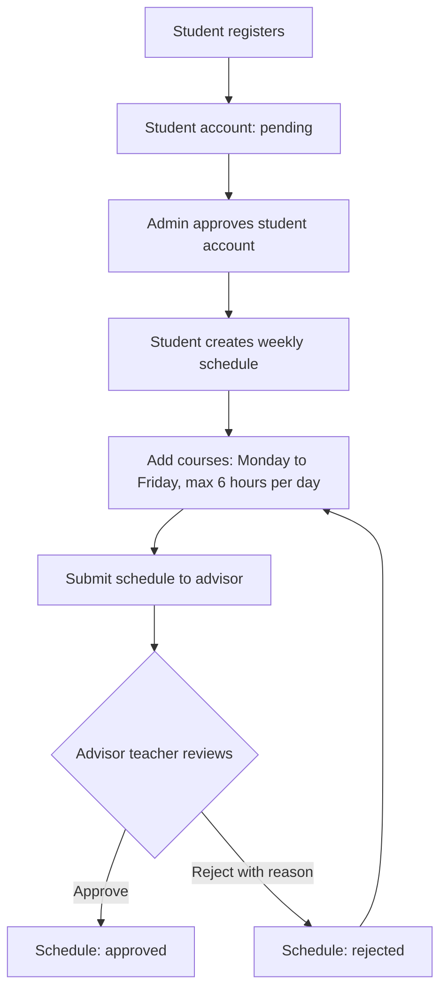

# StudentSchool

ระบบลงทะเบียนเรียนรายวิชาแบบรายสัปดาห์สำหรับสถานศึกษา รองรับ **Admin**, **Teacher** และ **Student**

## เอกสารโปรเจค

| เอกสาร | รายละเอียด |
| --- | --- |
| [โครงสร้างโปรเจค](ProjectStructure.md) | ตำแหน่งโค้ด Laravel, Vue, ฐานข้อมูล, tests และ workflow เอกสาร |
| [Module หลัก](Modules.md) | หน้าที่และหน้าใช้งานของแต่ละบทบาท |
| [Business Rules](BusinessRules.md) | กฎการลงทะเบียน ชั่วโมงเรียน และผู้อนุมัติตาราง |

## Flow หลัก

Admin อนุมัติ **บัญชีนักเรียน** ส่วนอาจารย์ที่ปรึกษา/อาจารย์ประจำชั้นตาม `students.advisor_teacher_id` อนุมัติ **ตารางเรียนรายสัปดาห์**

## เอกสารเพิ่มเติม

| เอกสาร | เนื้อหา |
| --- | --- |
| [SRS](SRS.md) | ความต้องการระบบและ API |
| [ER Diagram](ER_Diagram.md) | ตารางและความสัมพันธ์ของข้อมูล |
| [Data Dictionary](Data_Dictionary.md) | รายละเอียด field, ชนิดข้อมูล และข้อกำหนด |
| [Test Cases](TestCases.md) | สถานการณ์และผลที่คาดหวังสำหรับการทดสอบ |
| [Project Scope](ProjectScope.md) | งานที่ทำแล้ว ข้อจำกัด และ phase ถัดไป |

## ขอบเขตการเผยแพร่

เว็บนี้เป็นเอกสาร HTML จาก branch `main` ผ่าน GitHub Actions ไม่ใช่ production ของระบบ Laravel และไม่มีฐานข้อมูลหรือระบบ login บน GitHub Pages

วิธีติดตั้งแอปอยู่ใน [Repository README](https://github.com/sidaratkhaobang/studentSchool#readme) และ [Laravel README](https://github.com/sidaratkhaobang/studentSchool/blob/main/laravel/README.md)
